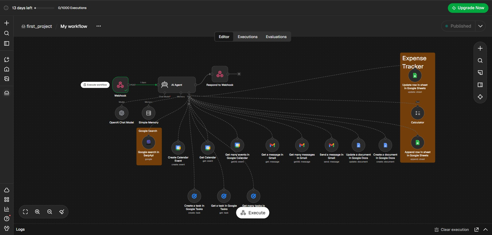
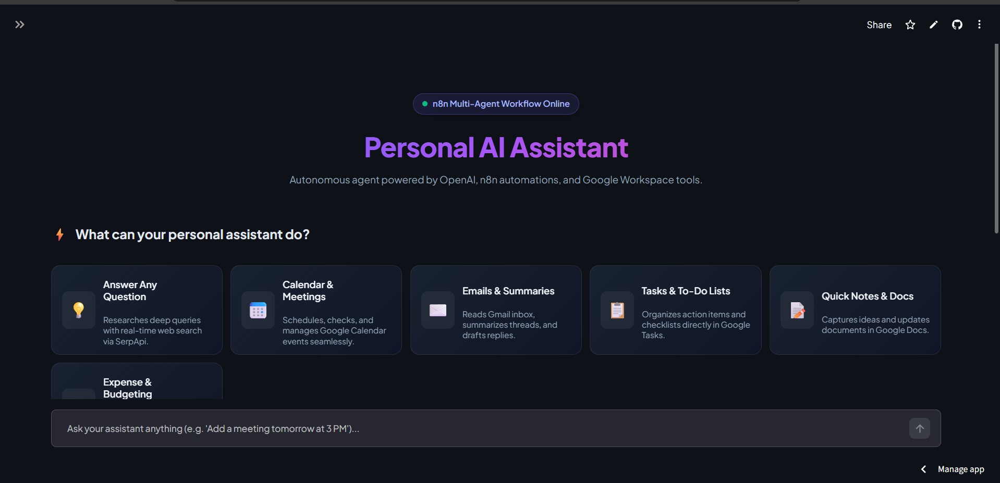
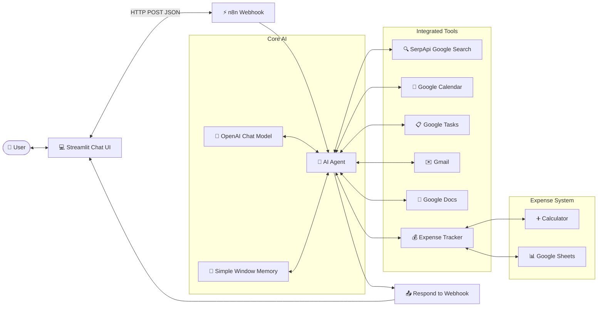

# 🤖 Autonomous Personal AI Assistant (n8n + Streamlit)

[](https://agenticai-28f4o89zzdnxz2nwwqqtd2.streamlit.app/)


An autonomous multi-tool **Personal AI Assistant** powered by an **n8n Agentic Workflow** and an interactive, responsive, animated **Streamlit** user interface. The assistant orchestrates multi-step tasks across real-world Google Workspace tools, real-time web search, and expense management using OpenAI LLM and conversational memory.

---

## 🌐 Live Application
Experience the live deployed application here:  
👉 **[https://agenticai-28f4o89zzdnxz2nwwqqtd2.streamlit.app/](https://agenticai-28f4o89zzdnxz2nwwqqtd2.streamlit.app/)**

---

## 📸 Workflow & Application Preview

### 1. n8n Agentic Automation Workflow
The backbone of this assistant is built using n8n's AI Agent architecture with conversational memory and multi-tool orchestration:



### 2. Streamlit Dynamic Web UI
Interactive, animated web chat interface with live n8n webhook integration:




---

## 🏗️ Architecture Overview



---

## ✨ Features & Integrated Tool Capabilities

As configured in the n8n agentic workflow:

| Tool Category | Node Name / Action | Capability |
| :--- | :--- | :--- |
| **🧠 Core LLM** | OpenAI Chat Model | High-reasoning chat model for tool selection, reasoning, and synthesis |
| **💾 Memory** | Simple Memory | Multi-turn conversational buffer memory for context retention |
| **🔍 Search** | Google Search in SerpApi | Real-time web browsing and information retrieval |
| **📅 Calendar** | Create, Get, & Get Many Events | Schedules, retrieves, and updates calendar meetings |
| **📋 Tasks** | Create, Get, & Get Many Tasks | Manages to-do lists and action items in Google Tasks |
| **✉️ Gmail** | Get Message, Get Many, Send Message | Reads, summarizes inbox emails and drafts/sends replies |
| **📄 Docs** | Create Document, Update Document | Takes meeting notes, drafts reports, and edits Google Docs |
| **💰 Expense Tracker**| Append Row, Update Row, Calculator | Performs calculations and logs financial records in Google Sheets |

---

## 🎨 UI Enhancements & Dynamic Features

- **📱 Fully Responsive Design**: Seamlessly adapts to smartphones, tablets, and desktop displays.
- **✨ Animated Glassmorphic Cards**: Smooth hover states, glowing borders, and modern micro-animations.
- **⚡ One-Click Quick Actions**: Pre-built interactive prompts (Schedule check, Email check, Expense logging, Task retrieval).
- **🟢 Live Webhook Status**: Live connection indicator connecting directly to your published n8n workflow.
- **⚙️ Configurable Webhook**: Easily swap between Test (`/webhook-test/`) and Production (`/webhook/`) endpoints right from the sidebar.
- **🗑️ Chat Management**: Instant chat history wipe and real-time interaction metrics.

---

## 📂 Project Structure

```text
n8n_workflow/
├── .streamlit/
│   ├── config.toml               # Streamlit theme & server settings
│   └── secrets.toml.example      # Sample secrets for Streamlit Cloud
├── screenshots/
│   ├── n8n_workflow.jpg          # n8n workflow canvas screenshot
│   └── streamlit_ui.png          # Streamlit UI screenshot placeholder
├── src/
│   └── n8n_workflow/
│       └── __init__.py
├── .env.example                  # Environment variable template
├── .gitignore                    # Git ignore file
├── .python-version               # Python version specification
├── app.py                        # Enhanced Streamlit web chat application
├── main.py                       # Project entrypoint launcher
├── pyproject.toml                # Project packaging configuration
├── requirements.txt              # Production dependencies for Streamlit Cloud
├── testwebhook.py                # Standalone script to test webhook response
└── README.md                     # Project documentation
```

---

## 🚀 Getting Started (Local Development)

### Prerequisites
- Python 3.11+ installed
- [uv](https://github.com/astral-sh/uv) (recommended) or standard `pip`
- An active n8n instance (Self-hosted or n8n Cloud) with the workflow published

### 1. Clone the Repository
```bash
git clone <your-repo-url>
cd n8n_workflow
```

### 2. Install Dependencies
Using **uv**:
```bash
uv sync
```
Or using standard **pip**:
```bash
python -m venv .venv
# Windows:
.venv\Scripts\activate
# Linux/macOS:
# source .venv/bin/activate

pip install -r requirements.txt
```

### 3. Run the Streamlit Application
```powershell
uv run python -m streamlit run app.py
# or
python -m streamlit run app.py
# or via main launcher
python main.py
```
Open your browser at `http://localhost:8501`.

---

## ☁️ Streamlit Cloud Deployment

This app is actively deployed at:  
👉 **`https://agenticai-28f4o89zzdnxz2nwwqqtd2.streamlit.app/`**

### Secrets Configuration on Streamlit Cloud:
In **Settings > Secrets**:
```toml
N8N_WEBHOOK_URL = "https://your-n8n-instance.app.n8n.cloud/webhook/your-webhook-id"
OWNER_ACCESS_CODE = "your-strong-passcode"
```

---

## 🔒 Security & Privacy Architecture

Because this assistant connects to personal Google Workspace tools (Gmail, Calendar, Tasks, Docs, and Sheets), the app uses a **two-mode access model** so it can be safely showcased publicly:

- **🛡️ Public Demo Mode (Default)**: Visitors and recruiters can explore the full UI and test every tool category with realistic simulated responses—**without** calling the live n8n webhook or exposing personal emails, calendar events, or triggering real actions.
- **🔓 Owner Mode (Passcode Protected)**: Entering the `OWNER_ACCESS_CODE` in the sidebar unlocks the live n8n webhook connection (stored strictly in `.env` or Streamlit Secrets, never hardcoded or displayed in the UI).

---

## 💡 Example Prompts to Try

- *"What meetings do I have scheduled for today on my Google Calendar?"*
- *"Check my unread emails in Gmail and summarize the most important one."*
- *"Add an expense of 450 INR for lunch into my expense sheet."*
- *"Add a task to Google Tasks: 'Prepare presentation deck by Friday'."*
- *"Create a Google Doc titled 'Agentic AI Roadmap' and add bullet points on n8n."*
- *"Search the web for the latest developments in humanoid robotics."*

---

## 👨‍💻 Author
**Abhishek Pathak**  
- Email: `abhishek.pathak01111@gmail.com`  
- Live Project: [agenticai-28f4o89zzdnxz2nwwqqtd2.streamlit.app](https://agenticai-28f4o89zzdnxz2nwwqqtd2.streamlit.app/)
